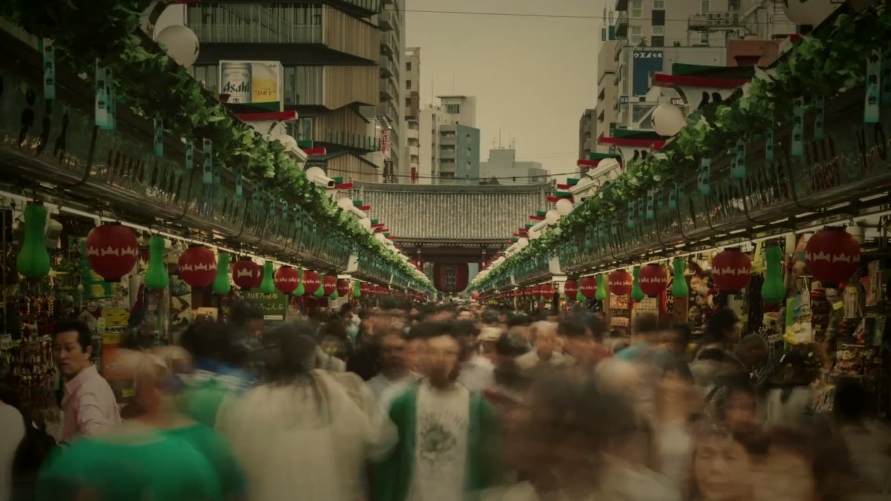
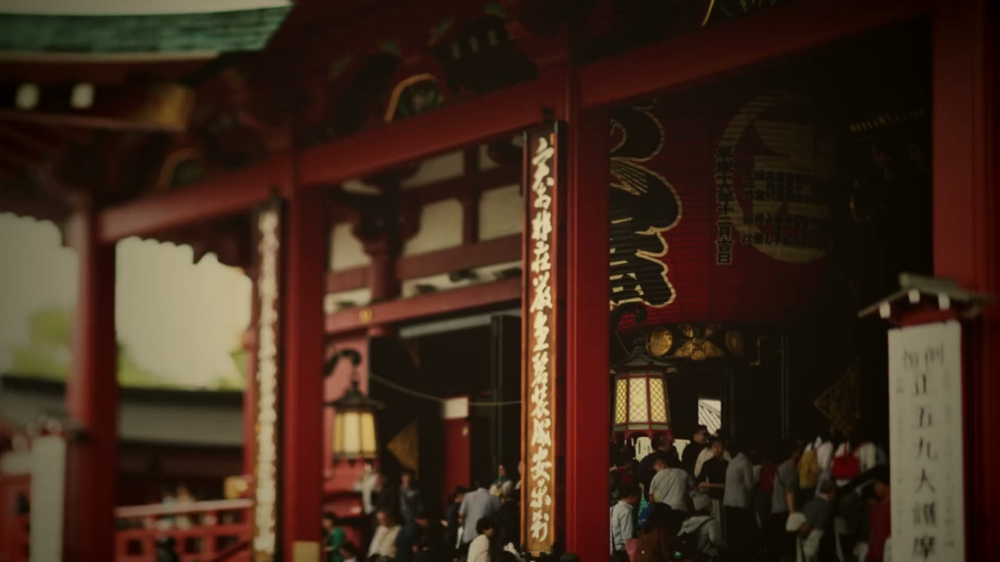

## Challenge

I wanted this site to open on something that feels like old 16mm film and still reads as a professional coder's site. It had to play behind the headline without slowing the page down.

## My role

I directed the film: the Japan-only idea, the shots and how it should feel. The footage is Mixkit stock, so none of the camera work is mine. The colour grade and the WebGL renderer were built with Claude, to my direction.

## Process

The reel runs a day in Japan from mist to rain, setting calm gardens and shrines against busy crowds. Each shot drifts on a slow camera move and a gentle speed ramp, then dissolves into the next through a warm film burn. The crowds print at 16 fps for a hand-cranked feel.

Only the base grade is baked into the clips: warm orange, soft contrast and no blue. Halation, grain and burns come from the shader, so they stay live. Text shake, iris wipes, whip cuts, a 4:3 frame and heavier grain all got cut for looking gimmicky or digital.

