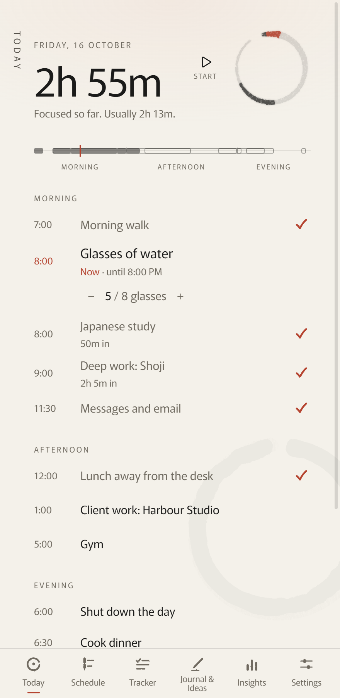
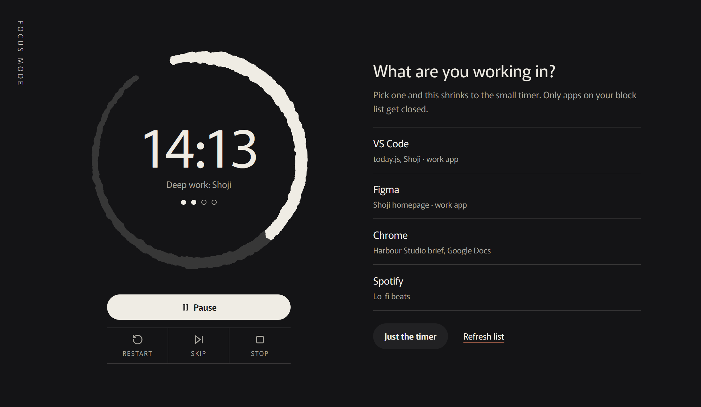
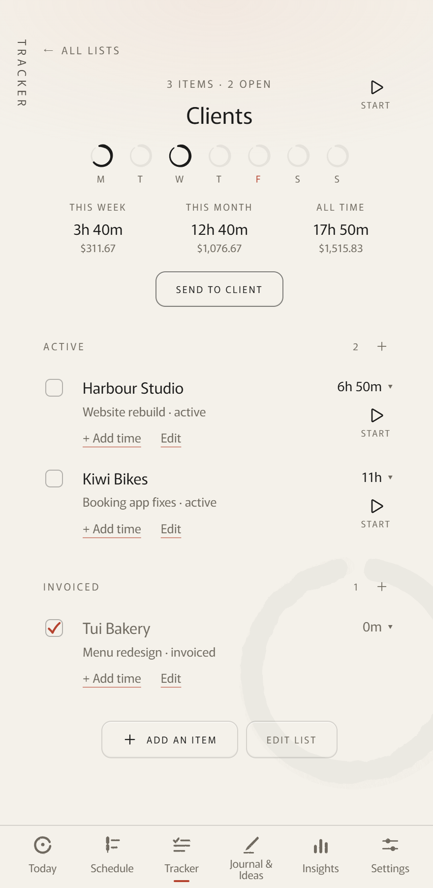
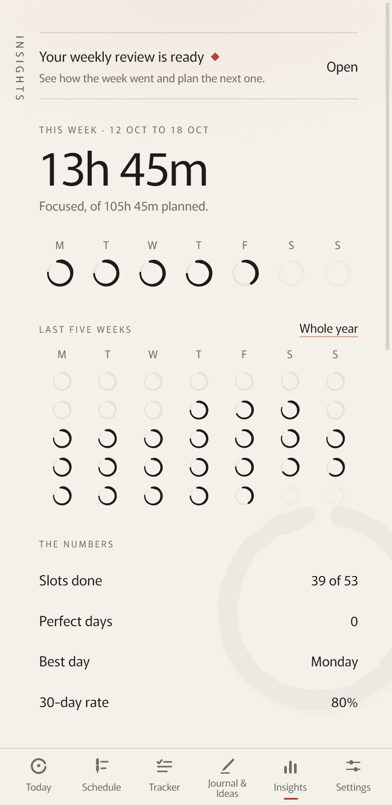

## Challenge

Working from home blurs the day. Shoji is a planner built to keep distractions out: you plan the day in blocks, start a focus timer when one begins, and close the day with a short journal note.

## My role

Everything: product design, the interface, the Electron build and the Japanese localisation. The brush-stroke rings, the day strip and the tab icons are drawn in code.

## Process

Shoji grew screen by screen: Today, Schedule, Tracker, Journal and Insights, each in light and dark. Tracker logs time against clients and turns it into what the week earned.

Insights turns the blocks you finish into weekly rings, numbers and streaks.

